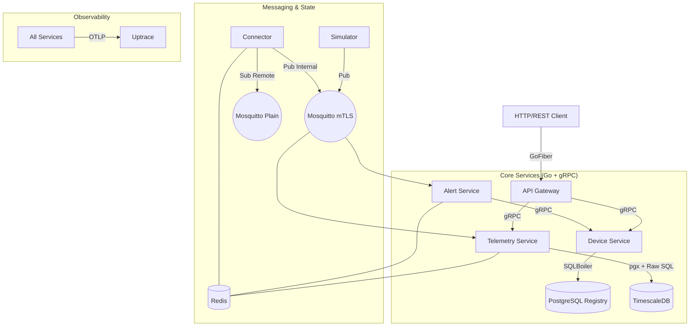
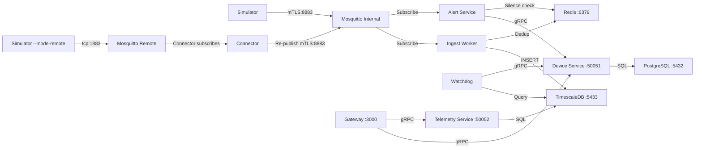

# FieldPulse 🚀
### Industrial IoT Backend Platform

---

## 👋 About Me
Hi, I'm **Vaishnav Mankar**.  
This project was a significant milestone for me. Before this assignment, I had zero experience with the **Go** programming language. Over the course of this project, I've learned to build high-performance distributed systems, manage observability with OpenTelemetry, and secure IoT communication with mTLS—all using Go. 

While it was a steep learning curve, I've made every effort to implement a robust, industry-standard platform. This is the technical assignment provided by [Golain.io](https://www.golain.io/)!

---

## 🏗️ Architecture Design


### **Detailed Data Flow & Network Architecture**



---

## 🛠️ Technical Implementation

### **1. TimescaleDB Performance Stack**
Our telemetry data uses advanced TimescaleDB features for long-term scalability:
*   **Hypertable**: The `telemetry` table is partitioned by `time` for high-velocity ingestion.
*   **Compression**: Data older than **7 days** is automatically compressed, reducing storage by ~90%.
*   **Retention**: Data older than **90 days** is automatically dropped to keep storage costs predictable.
*   **Continuous Aggregates**: An hourly view (`telemetry_hourly`) is materialized automatically for high-performance querying of historical trends.

### **2. Redis Infrastructure**
Redis manages transient system states:
*   **Deduplication**: 10m TTL lock on sensor packets to ensure "Exactly Once" processing.
*   **Alert Suppression**: 5m TTL window to prevent notification fatigue.
*   **Maintenance**: 10m (configurable) manual override to mute noisy sensors.
*   *See [CACHE.md](./CACHE.md) for detailed failure behavior and TTL strategies.*

### **3. Observability & Tracing**
The system is fully instrumented with **OpenTelemetry**.
*   **Trace Propagation**: Context is carried from the **API Gateway** $\rightarrow$ **Backend Services** and even across the **MQTT Message Bus**.
*   **Uptrace**: All traces are exported to Uptrace Cloud for real-time visualization.

---

## 🚀 One-Click Deployment
1. Build and start all 11 containers:
   ```bash
   docker-compose up --build
   ```
2. The `init-provisioner` will automatically bootstrap the system, register devices, and start the simulation.
