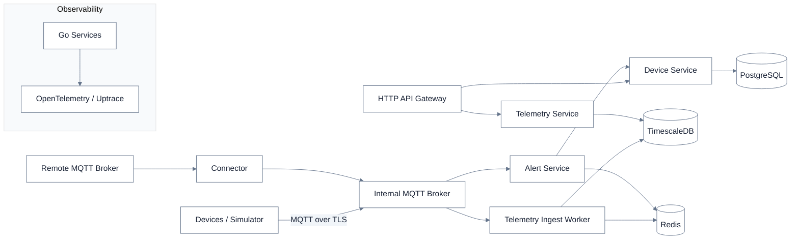

# FieldPulse

**A distributed backend for industrial IoT telemetry.**

FieldPulse connects device-facing MQTT messaging to backend services for device management, telemetry ingestion, alerting, and observability. The project explores how a multi-service Go backend can process device data while keeping operational state and historical telemetry in separate storage systems.

[View source on GitHub](https://github.com/myselfmankar/FieldPulse)

## Architecture

The system is organized around three parts: core API services, messaging and state, and observability.



## How data moves

1. **Ingest:** Device simulators publish telemetry through MQTT. A connector can bridge remote MQTT messages into the internal broker.
2. **Process:** The ingest worker consumes messages, validates and stores telemetry, and uses Redis for deduplication state. The alert service evaluates incoming events and coordinates with the device service.
3. **Serve:** The HTTP gateway exposes device and telemetry operations through backend services.
4. **Observe:** Services export traces through OpenTelemetry to Uptrace.

## Engineering highlights

- **Go services and gRPC** for separating gateway, device, telemetry, alerting, and ingestion responsibilities.
- **TimescaleDB** for time-series telemetry, including hypertables, retention, compression, and continuous aggregates.
- **Redis** for transient state such as packet deduplication and alert suppression windows.
- **MQTT with mTLS** for the internal device messaging path.
- **OpenTelemetry** for tracing across service and messaging boundaries.

## Run locally

The repository includes a Docker Compose environment for bringing up the services and simulator:

```bash
docker-compose up --build
```

See the [README](./README.md) for setup details, architecture notes, and the full deployment workflow.

---

<sub>Project showcase · Go · gRPC · MQTT · PostgreSQL · TimescaleDB · Redis · OpenTelemetry</sub>
