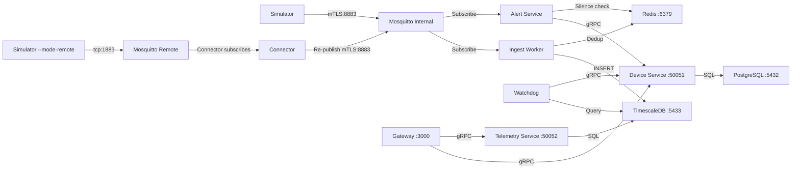

# FieldPulse Root Cause Analysis

I've reviewed **every file** in the codebase and cross-referenced against the [Uptrace Go docs](https://uptrace.dev/get/opentelemetry-go) and the Service Graph requirements you shared. Here's everything I found.

---

## System Architecture (for reference)



---

## Observability Status Per Service

| Service | `service.name` | Uptrace Init | gRPC Interceptors | Span Kinds | `deployment.environment` |
|---|---|---|---|---|---|
| **Gateway** | `api-gateway` | ✅ | ❌ Client missing | ❌ | ❌ |
| **Connector** | `outbound-connector` | ✅ | ❌ Client missing | ❌ (no kind set) | ❌ |
| **Device Service** | `device-service` | ✅ | ❌ Server missing | ❌ | ❌ |
| **Telemetry Service** | — | ❌ **NONE** | ❌ Server missing | ❌ | ❌ |
| **Alert Service** | `alert-service` | ✅ | ❌ Client missing | ❌ | ❌ |
| **Watchdog** | `status-watchdog` | ✅ | ❌ Client missing | ❌ | ❌ |
| **Ingest Worker** | `ingest-worker` | ✅ | — (no gRPC) | ✅ Consumer | ❌ |
| **Simulator** | — | ❌ **NONE** | — (no gRPC) | ❌ | ❌ |

---

## 🔴 CRITICAL Issues

### 1. Payload Deserialization Mismatch — All data ingested as `0.0`

> [!CAUTION]
> This is the **primary data flow bug**. Every telemetry reading stored in TimescaleDB has `temperature_c = 0`, `vibration_hz = 0`, `current_ma = 0`.

**The Simulator sends** (nested under `"metrics"`):
```json
{
  "device_id": "sim-device-000",
  "timestamp": "2026-04-12T...",
  "metrics": {
    "temperature_c": 24.5,
    "vibration_hz": 18.3,
    "current_ma": 552.1
  }
}
```

**The Ingest Worker deserializes into** ([model.go:8-15](file:///d:/GoLain.io/internal/telemetry/model.go#L8-L15)):
```go
type Reading struct {
    DeviceID      string    `json:"device_id"`
    Timestamp     time.Time `json:"timestamp"`
    Temperature   float64   `json:"temperature_c"`    // ← expects FLAT
    Vibration     float64   `json:"vibration_hz"`     // ← expects FLAT
    CurrentMa     float64   `json:"current_ma"`       // ← expects FLAT
    TraceContext  map[string]string `json:"_trace_context"`
}
```

The struct expects `temperature_c` at the **top level**, but the Simulator wraps them inside `"metrics": {...}`. Go's `json.Unmarshal` silently sets them to zero.

**Affected paths:**
- Simulator → Internal MQTT → Ingest Worker ❌
- Simulator (remote) → Connector → Internal MQTT → Ingest Worker ❌ (Connector's [normalizePayload](file:///d:/GoLain.io/cmd/connector/main.go#L278-L283) also nests under `"metrics"`)

---

### 2. No gRPC Interceptors — Service Graph Impossible

> [!CAUTION]
> Without OpenTelemetry gRPC interceptors, **all gRPC calls are invisible to Uptrace**. No client/server span pairs are created, so the service graph cannot be built.

**gRPC Servers (need `otelgrpc.UnaryServerInterceptor`):**
- [device-service/main.go:63](file:///d:/GoLain.io/cmd/device-service/main.go#L63): `s := grpc.NewServer()` — bare, no interceptors
- [telemetry-service/main.go:43](file:///d:/GoLain.io/cmd/telemetry-service/main.go#L43): `s := grpc.NewServer()` — bare, no interceptors

**gRPC Clients (need `otelgrpc.UnaryClientInterceptor`):**
- [gateway/main.go:65](file:///d:/GoLain.io/cmd/gateway/main.go#L65): `grpc.Dial(deviceSvcAddr, ...)` — no interceptor
- [gateway/main.go:71](file:///d:/GoLain.io/cmd/gateway/main.go#L71): `grpc.Dial(telemetrySvcAddr, ...)` — no interceptor
- [connector/main.go:102](file:///d:/GoLain.io/cmd/connector/main.go#L102): `grpc.Dial("127.0.0.1:50051", ...)` — no interceptor
- [alert-service/main.go:60](file:///d:/GoLain.io/cmd/alert-service/main.go#L60): `grpc.Dial(deviceSvcAddr, ...)` — no interceptor
- [watchdog/main.go:53](file:///d:/GoLain.io/cmd/watchdog/main.go#L53): `grpc.Dial(deviceSvcAddr, ...)` — no interceptor

**Service Graph requirements violated:**
- `_kind` (client/server span pairs) — **Required** ❌
- `rpc.service` attribute — **Optional** ❌
- `_status_code` — **Recommended** ❌

---

### 3. Telemetry Service Has Zero Observability

> [!IMPORTANT]
> [telemetry-service/main.go](file:///d:/GoLain.io/cmd/telemetry-service/main.go) has **no** `uptrace.ConfigureOpentelemetry()` call at all. This is a critical backend service that handles all query/read operations for telemetry data. It's completely invisible.

This violates the **`service.name` — Required** service graph attribute.

---

## 🟡 HIGH Severity Issues

### 4. No Span Kinds on Most Spans

Service graphs require **client/server** or **producer/consumer** span pairs. Currently:

| Span | File | SpanKind Set? |
|---|---|---|
| `Receive {topic}` | [connector/main.go:194](file:///d:/GoLain.io/cmd/connector/main.go#L194) | ❌ None (should be `SpanKindConsumer`) |
| `Ingest Reading` | [ingest-worker/main.go:117](file:///d:/GoLain.io/cmd/ingest-worker/main.go#L117) | ✅ `SpanKindConsumer` |

The Connector span needs `trace.WithSpanKind(trace.SpanKindConsumer)` and should create a `SpanKindProducer` span when re-publishing to internal MQTT.

### 5. No GoFiber HTTP Instrumentation on Gateway

The Gateway ([gateway/main.go](file:///d:/GoLain.io/cmd/gateway/main.go)) uses GoFiber but has no OpenTelemetry middleware. This means:
- HTTP requests from users are invisible
- No `server.socket.domain` or `server.socket.address` attributes — **Required for HTTP calls** per service graph requirements
- No HTTP span kind (server) to pair with the gRPC client spans

### 6. Simulator Has No Observability

[simulator/main.go:39](file:///d:/GoLain.io/cmd/simulator/main.go#L39) has a placeholder comment but no implementation. The Simulator is the **origin** of all telemetry data — without tracing here, you can't trace end-to-end.

---

## 🟠 MEDIUM Severity Issues

### 7. Alert Service Can't Parse Nested Metrics

Same flat-vs-nested bug as Issue #1. [alert-service/main.go:105-112](file:///d:/GoLain.io/cmd/alert-service/main.go#L105-L112):
```go
var rd struct {
    Temp    float32 `json:"temperature_c"`    // expects flat
    Vibe    float32 `json:"vibration_hz"`     // expects flat
    Current float32 `json:"current_ma"`       // expects flat
}
```

The payload has these nested under `"metrics"`. Result: `Temp`, `Vibe`, `Current` are always `0.0`, so alerts **never fire** (since 0 ≤ any threshold).

### 8. Double-Encoded CA Certificate in Device Provisioning

[cert.go:77](file:///d:/GoLain.io/internal/device/cert.go#L77):
```go
caPEM := pem.EncodeToMemory(&pem.Block{Type: "CERTIFICATE", Bytes: caCertRaw})
```

`caCertRaw` comes from `os.ReadFile("certs/ca.crt")` — which is **already PEM-encoded**. This wraps PEM-inside-PEM, producing an invalid CA certificate in the provisioning bundle. New devices would fail to establish mTLS.

**Fix:** Use `caCertRaw` directly as `CACert` in the bundle, or decode it first with `pem.Decode()` before re-encoding.

---

## 🔵 LOW Severity Issues

### 9. Duplicate/Conflicting Migration Files

Two migration files create the same `telemetry` table with **different column orders**:
- [002_telemetry_schema.sql](file:///d:/GoLain.io/migrations/002_telemetry_schema.sql): `device_id, "time", ...`
- [002_telemetry_hypertable.sql](file:///d:/GoLain.io/migrations/002_telemetry_hypertable.sql): `time, device_id, ...`

Different continuous aggregate names: `telemetry_hourly_stats` vs `telemetry_hourly`. Both are mounted in docker-compose. The `IF NOT EXISTS` clauses prevent hard failures but this is confusing.

### 10. No `deployment.environment` Set

Per [Uptrace docs](https://uptrace.dev/get/opentelemetry-go), `uptrace.WithDeploymentEnvironment("production")` helps with filtering. None of the 6 services with Uptrace set this.

---

## Service Graph Requirements Checklist

| Attribute | Status | Details |
|---|---|---|
| `service.name` | ⚠️ **6/8** | Missing on Telemetry Service and Simulator |
| `_kind` (span pairs) | ❌ **Broken** | No gRPC interceptors → no client/server pairs |
| `_status_code` | ❌ **Missing** | No span status codes set anywhere |
| `rpc.service` | ❌ **Missing** | Requires gRPC interceptors |
| `db.name` | ❌ **Missing** | Two databases but no DB instrumentation |
| `server.socket.domain` | ❌ **Missing** | No HTTP middleware on Gateway |
| `server.socket.address` | ❌ **Missing** | No HTTP middleware on Gateway |

---

## What Needs to Be Fixed (Priority Order)

1. **Fix payload deserialization** — Either flatten the Simulator's JSON or restructure `Reading` to handle nested `metrics`
2. **Add `otelgrpc` interceptors** to ALL gRPC servers and clients
3. **Add Uptrace init** to Telemetry Service and Simulator
4. **Add GoFiber OTEL middleware** to Gateway
5. **Set proper `SpanKind`** on Connector spans
6. **Fix double-PEM encoding** in cert.go
7. **Fix Alert Service** payload parsing
8. **Consolidate duplicate migrations**
9. **Add `WithDeploymentEnvironment`** to all services
